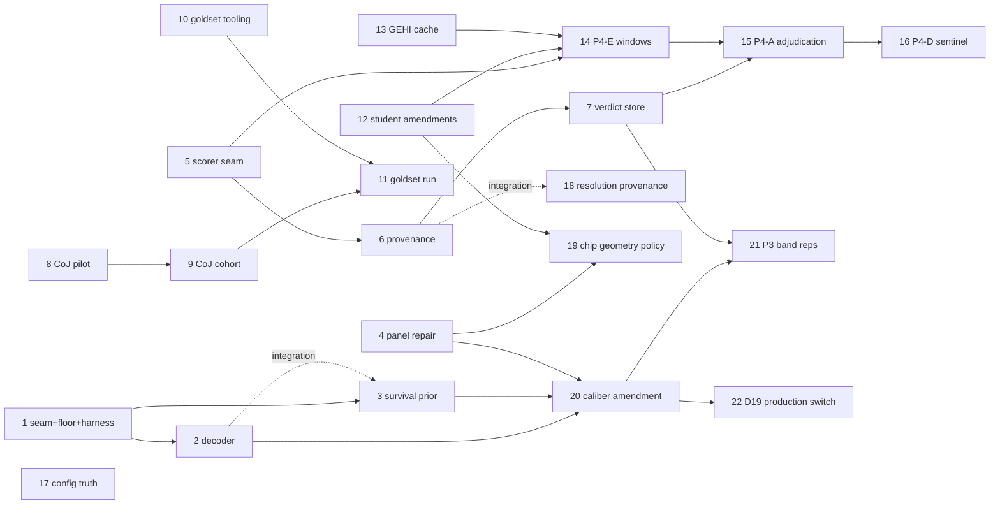

# Install-Date Optimization v2 — Execution Tracker

Source PRD: [`../install_date_optimization_v2_prd.md`](../install_date_optimization_v2_prd.md)
(READY, 2026-07-03) · Source analysis: [`../install_date_optimization_replan_2026-07-03.md`](../install_date_optimization_replan_2026-07-03.md)

Cape Town run-specific plan: [`RUN-cape-town-backdating-plan-2026-07-24.md`](RUN-cape-town-backdating-plan-2026-07-24.md) ·
execution tracker: [`RUN-cape-town-backdating-tracker-2026-07-24.md`](RUN-cape-town-backdating-tracker-2026-07-24.md)

**Full-timeline v2 ten-grid image pack (2026-10-05, images complete):**
Both download processes exited 0. The pack is
`~/zasolar_data/geid_temporal/reference_fulltimeline_v2_10grid_20261005/`.
Census aerials: 1,114 non-empty GeoTIFFs, 1,973,324,004 bytes, from
`fetch_cape_town_wms` at its fixed 768×768 size. TM z19 satellite chips:
53,035 files, 3,437,051,290 bytes, 493/493 cluster dumps ok, 0 crop failures.
QA keeps 53,031 release-eligible; 4 chips on 2022-12-30 are
`pixel_uninformative` (near-white) and must not be scored as usable frames.
TM z18: 180/180 ok, 2,169,474 bytes. Local citywide chip search was 0; the
GEHI tile cache supplied the satellite rebuild. No scoring was run. About
22 GB remains free on `/home`. CPT1956 anchors t00010449 and t00010452 were
a koko_v6 empty catalog (no_history, 4/4 queries succeeded, 0 dates), not a
real coverage gap. A 2026-10-05 GEHI re-query returned the neighbors' 73 TM
dates; 35 are downloadable from 2019-02-28 through 2024-05-30. Those 70 z19
chips were hardlinked into imagery/satellite_a3/chips/ beside the other
roofs. The two post-census references, 2025-02-28 and 2025-10-30, were
downloaded into that same tree. Each roof now has 37 z19 frames, the same
dates as neighbor t00010448, and those frames passed the pixel and footprint
gate. Aerial census frames were already in imagery/aerial/. The A3 manifest, sidecar, and QA table now include those 74 chips
(53,109 rows; 53,105 release-eligible; the original 4 near-white failures
remain). The citywide catalog outcomes for these two roofs are
tm_and_wayback, 73 TM dates and 8 Wayback dates, route recheck_20261005.
The full vintage CSV gained 162 rows and the 2019+ CSV gained 84 rows,
appended without rewriting the earlier lines. no_history on that catalog
is now 4. On 2026-10-05 the two roofs were rescored offline with the
published adaptive scanner (`gemini-3.1-flash-lite`, census bound
2025-01-31, 24 m review). Each has 12 evidence visits, all z19. After the
published dip repair, both are `done_appears`: t00010449 brackets
2022-03-30 to 2022-04-30 (midpoint 2022-04-14; four raw interior absents
were flipped), and t00010452 brackets 2024-02-29 to 2024-05-30 (midpoint
2024-04-14; no flips). The local 2026-09-02 install table, its GPKG, and
the 2026-09-23 visit sequences now carry those rows. Dated brackets are
73,338 and undated roofs are 1,029. Sequence coverage is complete 90,350
and missing_scan_state 21,451. The Dropbox research previews were not
changed; the citywide CSV there is still
`c0bf9ed149fb73a97f34354c82f881df3f45769cfafe1e44e9fc68b1e29e7563`.
The descriptive HTML and the 27-wave packages were not rebuilt. Run note:
[`RUN-fulltimeline-v2-10grid-image-pack-2026-10-05.md`](RUN-fulltimeline-v2-10grid-image-pack-2026-10-05.md).

**Full-timeline reference v2 (2026-10-06, scoring running in tmux; not finished):**
The image pack is complete. The run note
[`RUN-fulltimeline-reference-v2-10grid-2026-10-05.md`](RUN-fulltimeline-reference-v2-10grid-2026-10-05.md)
drops five gates that must not block scoring: native-resolution aerial
re-download (use the existing 768×768 GeoTIFFs), a fuller post-census
satellite re-query (use the on-disk `post_census` frame, rank 1), holding
every roof for aerial-identity adjudication, re-reading the Dropbox citywide
tar, and a simulated-failure matrix. Kept: T3 is candidate + census aerial +
one post-census satellite reference; T2 is the same candidate and aerial on
the 149 paired roofs only; a missing declared image is not a successful call;
a 2024 pre-census fallback is not the T3 reference; the scan does not stop at
the first present; voided v1 labels are not reused. Measured work is 51,212
callable in-window dates, 7,102 paired callable dates, and 4 near-white chips
on CPT2935 dated 2022-12-30. The 4,555 incomplete-coverage dates stay
unscored. A development-grid smoke on 2026-10-06 sent four T3 and four T2 calls.
Logged T3 bodies have three images and T2 bodies have the same candidate
and aerial with no satellite hash. Returned modelVersion is
`gemini-3.1-flash-lite`. SCORE_DONE was not written for the smoke.
Session `v2_10grid_score` is scoring the full window at concurrency 8.
51,208 dates are sendable and the 4 near-white chips are non-calls.
Development versus evaluation interval counts are not written yet
because the full ledger is still open. Results must not claim native-resolution
aerials, a clearest frame from the full pool, or that a narrower interval is
higher accuracy. The replacement
[plan](PLAN-fulltimeline-reference-v2-10grid-2026-10-05.md) still records
those dropped gates. V1 results remain void.

**Full-timeline Lite reference pilot (2026-10-05, scored result VOID):**
Frozen Cape Town centroid grids, seed 20261004, window `capture_date >= 2019-01-01`
and before the policy census bound 2025-01-31. Measured inventory is N=1114
anchors, H=51142 downloadable in-window candidates, H_pair=7067, 149 paired
anchors and 85 nested review anchors. Development grids CPT2304 and CPT3359;
eight evaluation grids. Preflight admitted `gemini-3.1-flash-lite`. A numeric
`candidate_index` enum was an HTTP 400; the frozen schema now uses the string
enum `"1"` and still requires the integer 1. Scoring keeps 8 requests in
flight because the serving account allows 10 concurrent calls. At
2026-10-04 17:03Z the scorer exited with `pending_manifest=49768`: a quota
pause recorded no raw row in that batch, and the drain treated the pause as
"no progress" and stopped. The drain now retries after that sleep. The
recheck sentinel written during that partial pass is removed; raw responses
and the quota ledger stay. Manifest and pending lookup now use one raw
index, so a chunk of calls is not followed by a full rescan. Scoring session
`fulltimeline_lite_10grid` resumes from
`~/zasolar_data/geid_temporal/reference_fulltimeline_lite_10grid_20261004/`.
At 2026-10-04 18:05Z the only gateway account then mapped to
`gemini-3.1-flash-lite` returned an upstream quota 429 and stays limited
until `2026-10-04T21:37:15Z`. More accounts were given that model map later.
The same scorer woke at 20:27Z and continued on those accounts without
changing the alias. At 2026-10-05 02:44Z that process exited 0.
`observations/SCORE_DONE.json` records `pending_manifest=0` and
`n_requests=58205`. The bounded recheck then wrote
`observations/RECHECK_DONE.json` with `n_recheck_requests=2308`. The log
line is `pending_manifest=0` and `recheck_new_requests=2242`, then
`EXIT:0`. No scorer is still running. Raw responses and the quota ledger
stay. The offline audit then ran twice and agreed:
`audit_ok=true`, valid-response rate 0.999725, candidate-byte agreement
1, `accuracy_pass=false`. Intervals from the single-candidate labels are
bounded 434, conflict 448, undated 232. The two-frame versus three-frame
effect denominator is 0: all 1,114 aerial crops failed, and both arms were
scored as the candidate image alone. Same-image arm disagreements (514
dates) are repeat noise, not a frame-count result. Adaptive replay on
these labels picked 16,913 dates and skipped 38,776. No human adjudication
was added. Owner decision the same day: the scored result is void. Each
Gemini request contained one image, so the labels are not a two-frame or
three-frame result and are not a clean single-image baseline. Do not use
the intervals or these labels. The satellite chip pixels were deleted the
same day to free disk. Keep the raw log, plan, audit tables, A3 manifest,
and quota ledger. Do not rerun these 10 grids on the same local aerial
store. Run note:
[`RUN-fulltimeline-reference-lite-10grid-2026-10-05.md`](RUN-fulltimeline-reference-lite-10grid-2026-10-05.md).

**Aerial pre-detector gate review (2026-10-02, cross-project diagnostic):**
Owner confirmed Cape Town-only scope; paired DINOv2/YOLO30 scores
cover 26 grids (53,508 chips). No large global adjacent-score gap. Exploratory gaps
within 4,282 reference-positive chips select DINO 64 / YOLO 301,
union 302, plus 18 controls. **Owner retired Pro on 2026-10-02: do not
use it for fresh reviews or current conclusions.** Its old 320 labels
are historical only. Reviewer default is now `gemini-3.8-flash`, with
`gemini-flash-3.5-lite` the only allowed alternative; requests and
responses using Pro are rejected. Same-image Flash recheck completed
all 320; all successful responses report `gemini-3.8-flash`. Low-tail
302: 76 present / 225 absent / 1 uncertain; DINO tail: 3 / 61 / 0;
YOLO tail: 75 / 225 / 1. One output-truncated six-image batch was
retried with a larger output budget; 53 successful batches reused.
Current gallery and CSV now show Flash; Pro snapshots are retired.
Two model-policy tests and result-page type checking pass.
These remain auxiliary model judgments, not human truth or permission
to raise thresholds; 137/302 reference overlaps are <1 m². Reference labels,
model weights, inventory, and production thresholds remain unchanged.
Data: `~/zasolar_data/geid_temporal/aerial_gate_tail_review_20261002/`.
Run: [`RUN-aerial-gate-tail-gemini-review-2026-10-02.md`](RUN-aerial-gate-tail-gemini-review-2026-10-02.md).

Delivery review package (2026-09-27): Cape Town / Johannesburg chips beside
the frozen install-date status. Evening redraw drops Cape Town `cohort=top52`
and draws 2 roofs from each `scan_status` × area band (`<20`, `20–100`,
`≥100` m²): 30 + 37 roofs, 571 images, 0 gaps. Archive sha256
`cacb571876efe6c86931d1c725cdd3abcfa19f93aef43d6532c2a3b94ccca63f`
(198,997,275 bytes). Builder
`scripts/temporal/build_delivery_review_package.py`. Package (not in git):
`~/zasolar_data/geid_temporal/delivery_review_package_20260927/`. Dropbox copy
replaced the morning archive in
`~/Dropbox/RA_Solar/Gao/backdating/delivery_review_2026-09-27/`.
Note: [`RUN-delivery-review-package-2026-09-27.md`](RUN-delivery-review-package-2026-09-27.md).

Cape Town citywide disk pipeline (rev-6.2, 2026-08-26, D7+D9 topology,
E0+E6 signed D10):
[`RUN-cape-town-citywide-batch-disk-pipeline-2026-08-18.md`](RUN-cape-town-citywide-batch-disk-pipeline-2026-08-18.md)
— Dropbox 主归档 · koko 轻载 · A3 dump 生产路径（D5/D6）· Gemini 留在
rog（D7）· grok bot 跑在 **cursor**，可半波下载（D9）· bot prompt
[`HANDOFF-ct-citywide-cursor-bot-2026-08-26.md`](HANDOFF-ct-citywide-cursor-bot-2026-08-26.md)

A3 region-batch pilot (2026-08-18): **MIXED** on the preregistered
`download` arm —
[`RUN-a3-region-batch-pilot-2026-08-18.md`](RUN-a3-region-batch-pilot-2026-08-18.md) —
but **GO on the `dump` arm**, same day:
[`RUN-a3-region-batch-dump-arm-2026-08-18.md`](RUN-a3-region-batch-dump-arm-2026-08-18.md).
The dump+lossless-stitch arm is now in the library with offline tests
(`gehi_region_batch.py` + driver stages `batch_dump`/`compare_dump`/`report_dump`);
both CPT2713 and CPT3584 pass all 7 prereg bars (median MAE 1.93, 24/24 ≤5,
QA 24/24, invocations 2 vs 24). New gotcha encoded in the stitcher: GEHI .jgw
C/F are tile CORNERS, not ESRI-convention pixel centers (half-pixel trap).
Handoff (2026-08-19):
[`HANDOFF-a3-region-batch-2026-08-19.md`](HANDOFF-a3-region-batch-2026-08-19.md)
§7 steps 1–2 done. **Owner accepted the ~2 DN dump chips as the scoring truth
source on 2026-08-19 ([OWNER_DECISIONS D4](OWNER_DECISIONS.md))** — truth-source
equivalence only, not a production switch. Follow-through same day
([`RUN-a3-fullcell-coldcell-probe-2026-08-19.md`](RUN-a3-fullcell-coldcell-probe-2026-08-19.md)):
full-cell union probe (341 anchors / 1.1 km) reports **57 complete dates**;
cold non-Top-52 cell (CPT1953, 2025-10-30) re-passes all 7 dump-arm bars
(median MAE 2.78) with cold wall-clock **17.2× ≈ cache-hot 17.8×** — the tax is
process+interval, not bytes; dump→per-anchor manifest synthesis passes the
production `quality_gate` unchanged (24/24 pilot, 12/12 cold). Handoff §8 open
items all closed. **Owner then signed the production path on 2026-08-19
([OWNER_DECISIONS D5](OWNER_DECISIONS.md))**: dump arm replaces ALL per-anchor
downloads, plus a full-cell pilot and a 10-grid canary before scale-out.
Executed same day:
[`RUN-a3-batch-lane-canary-2026-08-19.md`](RUN-a3-batch-lane-canary-2026-08-19.md)
— production lane `run_a3_batch_lane.py` (fail-closed >10 grids without
`ENABLE_REGION_BATCH=true`); full-cell pilot 1 call / 341 anchors, QA 341/341;
10-grid canary 14,796 chips, QA 14,795/14,796 (99.99%), no 403; canary caught
GEHI dump SILENTLY SKIPPING vintage-uncovered tiles (99 holes in non-member
rectangle areas) — fixed with hole-tolerant stitch + surgical crop-level
fallback, steady-state ≈ 296 calls vs 14,796 sequential (~50×). **Owner released
`ENABLE_REGION_BATCH=true` on 2026-08-26 ([OWNER_DECISIONS D6](OWNER_DECISIONS.md))**
— scale-out of `run_a3_batch_lane.py` past the 10-grid cap is authorized.
`launch-wave` wired to A3 dump on 2026-08-26 (`run_a3_batch_lane.py`,
tmux `ct_cw_wNN_a3`, `ENABLE_REGION_BATCH=true` at process start).
D9: grok bot host is tailnet **cursor**; it may run half the A3 dump
grids (high BW) and rsync chips to rog. Prompt:
[`HANDOFF-ct-citywide-cursor-bot-2026-08-26.md`](HANDOFF-ct-citywide-cursor-bot-2026-08-26.md).
Top-52 B1: three tar volumes on Dropbox (38.738 GiB). **Local release
DONE 2026-08-26 08:32:42Z** (`RELEASE_OK`; 1,208,195 `.tif` deleted;
koko 23G copy gone; `/home` 77G→115G avail). Leftover ~26G under the
old chips tree is provenance/deletion jsonl + empty dirs, **0 tif**.
**E0+E6 signed D10.** Rog half-wave A3 is already running (`tmux
ct_cw_w01_a3_rog`).
**wave_03 release 2026-08-27:** `chip_lifecycle.py release` finished
(`RELEASE_OK` 2026-08-27T11:45:15Z; 154,577 `.tif` deleted + hashed
into one backfill sidecar). The `--anchor-ids-file` filter used
`entry in kept` on a **list** (O(n²) ChipEntry compares); that pegged
one P-core ~25 min before any hash/delete. Fixed: path-set membership
in `apply_anchor_filter`; `describe()` now previews 20 backfill lines
instead of dumping every path (the wave_03 log grew to 54 MB).
**wave_22 release 2026-09-01:** same O(n²) list membership came back in
the uncommitted working tree (`plan.to_backfill = [e for e in
to_backfill if e in kept]`), so `release-wave 22` CPU-spun with
`wchar=0` after reading ~2.5G (hotset still 37G, no `RELEASE_OK`).
Restored `apply_anchor_filter` path-set + `describe()` preview 20;
kept the later `.tfw` companion unlink. Snapshot:
`pipeline/watch/w22-release-review/`. Re-run `release-wave 22` against
the restored file; do not kill a process that has already started
hash/unlink.
**Scoring rate contract 2026-08-26:** citywide `score-wave` is
`--anchor-workers 40 --qps 6 --gemini-max-in-flight 40`. QPS 6 is the
startup ramp (about 6 new HTTP in the first second, so Sub2API can
spread load across accounts). 40 is the later ceiling, not a chop: do
not set `max_in_flight` equal to QPS. RateLimiter now assigns start
times under a lock and sleeps outside it, so 40 waiters cannot share
t=0.
**Wayback dump CRS 2026-08-28:** production A3 crop treated Wayback
`.jgw` metres as degrees (wave_03 `a3_rog_v4`: TM 0/51310 crop-fail,
Wayback 6667/6672). Stitch now infers EPSG:4326 vs EPSG:3857 from
world-file units; crop projects the WGS84 bbox into the mosaic CRS.
Offline tests replay the exact production window
`[-6849987:-6849986,-13535630:-13535629]` → `[1526:1925, 4034:4415]`.
Do not restart wave_04; the next wave process picks this up. Write-up:
[`DATA-a3-wayback-dump-crs-2026-08-28.md`](DATA-a3-wayback-dump-crs-2026-08-28.md).
**Disk cleanup 2026-08-28:** deleted
`~/zasolar_data/geid_temporal/a3_canary_20260819` (6.5G, canary
complete) and `ct05_catalog_v1/routes_new` plus the four E2 lane
`*.tar.gz` transfer blobs. Did **not** delete `ct05_catalog_v1/merged/`
(8.3G, live offline TM catalog + `.done`) or `plan/` (anchors roster).
`/home` 207G→201G used, 36G→43G avail. Remaining pressure is unreleased
A3 lane copies on waves 01–04, not leftover wave backup tars.

**Literature intake 2026-09-01:** owner-facing problem packet —
[`../briefs/BRIEF-open-problems-lit-intake-2026-09-01.md`](../briefs/BRIEF-open-problems-lit-intake-2026-09-01.md).
**Return same day** (A–G verified, 14 papers with mechanism-diff vs §4
kills): [`../briefs/SRC-open-problems-lit-2026-09-01.md`](../briefs/SRC-open-problems-lit-2026-09-01.md).
No assembly of sparse-GEHI + unusable-exit + contrast-conditional small-array
scoring + independent date GT exists; stop a third literature round. Decision memo:
[`../briefs/BRIEF-lit-intake-next-plan-2026-09-01.md`](../briefs/BRIEF-lit-intake-next-plan-2026-09-01.md)
— recommend V2: run S2 EIG replay **in parallel with** r4_v2 (zero GPU /
quota); small-array policy is **conditional usable** (chip usable ∧
panel–roof colour separable ∧ no same-scale distractor), **not** a
blanket `<15 m²` layer-kill and **not** a citywide recut; D2 LoRA if
triggered spends on abstention by default, pairing only vs a
param-matched frame-wise LoRA control. **Owner leaning 2026-09-02:**
refuse the area-layer abstain; prove/kill the colour-blob rule with
stratified human 3-state labels. Sign-off on S2-parallel and the
conditional-usable wording is still open.

**Citywide Gemini decode + descriptive stats 2026-09-02:** 27-wave
scoring is complete (`SCORE_OK`+`RELEASE_OK`+rescue all 27;
90,348/90,348 terminal). Decode used Lite primary + 3.6-high rescue of
ambiguous + CPT3622 Lite rescore. Same-day alignment recovered the
Top-52 row-level deliverable from Dropbox
(`ct_top52_install_dated_20260803_lite_v2.csv`) and joined it 1:1 onto
the citywide 111,801-anchor set (disjoint union, 0 gaps). Combined after same-day wave_04 rescue un-supersede: dated **73,336
(65.6%)**, bounded **100,927 (90.3%)**, interval median 37 days,
`gemini_failed` **0**. The 638 wave_04 "failures" were Lite
nonmonotonic overwritten by a dead 3.6 rescue (Antigravity 400
`project_id`); revert + dip-repair recovered 380 dated + 217
left-censored, 41 stay nonmonotonic. Two Esri-basemap figures: coverage
class (Muizenberg orange cluster gone) and **H3-7** choropleth of dated
median year (381 cells / 273 mapped). Row table carries `h3_r7`.
HTML: `~/zasolar_data/geid_temporal/cape_town_citywide_backdating_v1_20260812/e8_descriptive_20260902/descriptive_stats_2026-09-02-citywide-aligned.html`.
Same-day citywide CSV/GPKG research preview (111,801 polygons, Top-52
schema + `h3_r7`/`source_kind`/`wave`/`cohort`; all structural gates PASS):
local `deliverable_2026-09-02/`, Dropbox
`RA_Solar/Gao/backdating/ct_citywide_install_dated_2026-09-02_research_preview/`.
Write-up:
[`DATA-cape-town-citywide-gemini-descriptive-2026-09-02.md`](DATA-cape-town-citywide-gemini-descriptive-2026-09-02.md).
Coverage + polygon table, not E8 multi-model panel review and not an
accuracy claim.

**Citywide visit sequences 2026-09-23:** the frozen 111,801-row preview
stays at its 2026-09-02 hashes. A sibling table adds the per-visit
sequence for the 90,348 `citywide_27wave` anchors (1,291,477 evidence
frames; repaired 0/1/u counts and `latest_absent_date` match the
preview on every row). 13,157 anchors / 52,212 dates differ between the
raw model code and the dip-repaired code the interval counts use.
Top-52's 21,453 rows are `missing_scan_state` (the `/tmp/ct52_interval_states…`
JSON is not in the tree). The same sequences are also a 101-column
anchor×date panel (2019-01-15 … 2025-01-30; blank = not imaged, `u` =
unusable). Repaired and raw panels differ in 52,212 cells. Local:
`sequences_20260923/`. Collaborator package for the 90,348 27-wave
roofs only (long visits + roof-level monotonicity and k=1/2/3
confirmation; not the 101-column sheet):
`deliverable_27wave_20260923/`. Same-rule date×installed panel as JHB
(`ct_27wave_install_panel.csv`, 5,061,495 rows; Top-52 excluded)
plus `scan_states/ct_27wave_scan_states.tar.zst` (90,348 merged JSON):
Dropbox `presence_panels/cape_town/`. Write-up:
[`DATA-cape-town-presence-sequences-2026-09-23.md`](DATA-cape-town-presence-sequences-2026-09-23.md).

**Municipal true-date layers 2026-09-06** (collaborator: dating precision
not enough; catalog other ways to build the panel):
[`../briefs/SRC-municipal-layers-2026-09-06.md`](../briefs/SRC-municipal-layers-2026-09-06.md)
+ decision memo
[`../briefs/BRIEF-municipal-true-date-panel-2026-09-06.md`](../briefs/BRIEF-municipal-true-date-panel-2026-09-06.md)
+ HTML briefing
[`../briefs/BRIEF-municipal-true-date-panel-2026-09-06.html`](../briefs/BRIEF-municipal-true-date-panel-2026-09-06.html).
Two-set CSVs: aerial
[`../briefs/_muni_catalog/aerial_city_summary.csv`](../briefs/_muni_catalog/aerial_city_summary.csv)
/
[`../briefs/_muni_catalog/aerial_layers.csv`](../briefs/_muni_catalog/aerial_layers.csv)
(110 layers); satellite
[`../briefs/_muni_catalog/satellite_layers.csv`](../briefs/_muni_catalog/satellite_layers.csv).
Live REST: Cape Town almost-annual 8 cm 2012–2022 and 5 cm 2025–26 (2023Jan
is NGI 25 cm; 2024 is ~30% metro); Johannesburg 15 cm 2009–2023 plus coarser
2000–06; eThekwini 10 cm 2016/18/19/20/22 (847k dated building footprints);
Ekurhuleni 10 cm 2013/18/20; Tshwane 10 cm 2018+2023 on `e-gis001` (the
`gis.tshwane.gov.za` host is 503); NMB via resource-proxy (1997–2022, 5 cm
from 2017). Buffalo / Mangaung / Msunduzi: no live municipal ImageServer.
NGI 0.25 m does not beat GEHI z19. Recommend V2 probe
(CT-11 100 anchors × CoCT 2018/2022/2025, census detector, no Gemini) —
unsigned.
**Satellite H3-7 rollup 2026-09-06** (reuse catalogs, no live GEHI):
[`../briefs/SRC-satellite-layers-h3r7-2026-09-06.md`](../briefs/SRC-satellite-layers-h3r7-2026-09-06.md).
CT 381 cells: Google Earth TM z19 median **107** bbox-complete dates/anchor
(2009–2025), Wayback z19 median **9**; z18 is fallback; **z20 not in the
citywide catalog**. JHB 83 cells: TM 2019+ window only; Wayback z19 back to
2012. Other metros had no GEHI catalog. **Live GEHI `info` 2026-09-13 done**
(2,296 / 2,296, 0 fail): all **1,148** unique Vexcel-covered H3-7 centroids
× {TM, Wayback} × z19. Independent SRC
[`../briefs/SRC-satellite-vexcel-h3r7-gehi-info-2026-09-13.md`](../briefs/SRC-satellite-vexcel-h3r7-gehi-info-2026-09-13.md).
TM median dates: CT **113**, JHB **90** (2009–2026, not the old 2019+ clip),
eThekwini 89.5, NMB 91, Buffalo 107, Ekurhuleni spill 129, Tshwane **49**,
Mangaung 51, Msunduzi 45. Wayback median 9–13 in large metros, 1–2 in
Buffalo / Mangaung / Msunduzi. Centroid `info`, not bbox-complete. Do not
grid cadastral hinterland.
**Availability pack 2026-09-14** (year class + 1–2 frame flags):
[`../briefs/BRIEF-satellite-availability-2026-09-14.html`](../briefs/BRIEF-satellite-availability-2026-09-14.html)
+ fig1 heatmap
[`../briefs/FIG-satellite-year-heatmap-2026-09-14.html`](../briefs/FIG-satellite-year-heatmap-2026-09-14.html)
+ fig2 three-layer
[`../briefs/FIG-layer-availability-2026-09-14.html`](../briefs/FIG-layer-availability-2026-09-14.html).
TM `sparse_1_2` (at most 2 dates/cell and under half of Vexcel cells): **9** city-years,
led by JHB 2023 (32/74, 1.00) and Ekurhuleni 2023 (4/23); Wayback + CoJ
aerial fill JHB 2023 as a year-panel, not a day interval. Write-up
[`DATA-satellite-vexcel-h3r7-availability-2026-09-14.md`](DATA-satellite-vexcel-h3r7-availability-2026-09-14.md).
**H3-7 spatial coverage map 2026-09-14:**
[`../briefs/FIG-h3-spatial-coverage-2026-09-14.html`](../briefs/FIG-h3-spatial-coverage-2026-09-14.html)
joins urban-centre cells to Vexcel + TM dates on the same `h3_index`.
JHB urban-centre gap **191 / 264**; of 74 Vexcel cells only **32** have TM 2023.
CSV [`../briefs/_muni_catalog/satellite_vexcel_h3r7_spatial.csv`](../briefs/_muni_catalog/satellite_vexcel_h3r7_spatial.csv).
**Vexcel municipality metadata 2026-09-06** (live API, H3-7 vs geoBoundaries
polygons, 1% overlap):
[`../briefs/SRC-vexcel-layers-h3r7-2026-09-06.md`](../briefs/SRC-vexcel-layers-h3r7-2026-09-06.md).
**12** urban `final-ortho` collections, not the 7 in the 2026-08-12 file.
Cape Town **is** covered: five `za-wc-*-2024` tiles, **367 / 603** metro
H3-7 (60.9%), **278 / 381** census cells (73.0%), ~6.2 cm, 2024-03-18 …
2024-04-12 — spatial partitions of one season, not five years. JHB 74/350
(21.1%, Sandton/Soweto 404); Ekurhuleni has no own collection (23-cell
JHB spill). One vintage per city; not a year panel.
**Vs GHSL 2020 Urban Centre (城区, 2026-09-06):** CT **93%**, NMB **100%**,
Msunduzi 94%, eThekwini 79%, Mangaung 72%, Buffalo 67%, Tshwane 48%,
**JHB 27%**, Ekurhuleni 7%. CoJ is already 68% urban-centre land — the
21% metro rate is not hinterland. Table:
[`../briefs/SRC-vexcel-layers-h3r7-2026-09-06.md`](../briefs/SRC-vexcel-layers-h3r7-2026-09-06.md) §2.1.
**Layer-metadata reading pack 2026-09-15** (no new probe; 09-06/13/14
numbers re-checked against CSV): Dropbox
`RA_Solar/Gao/backdating/sa_layer_metadata_2026-09-15/` · local
`~/zasolar_data/geid_temporal/sa_layer_metadata_2026-09-15/` · start at
pack `README.md`. Write-up
[`DATA-sa-layer-metadata-pack-2026-09-15.md`](DATA-sa-layer-metadata-pack-2026-09-15.md).

**Goal:** reproducible-and-bounded-accurate install dates via five layered
phases — deterministic decoder (P0), provenance + verdict store (P1), external
accuracy channel (P2), corrected student distillation (P3, governed by the
[dinov3 tracker](../dinov3_scorer/TRACKER.md)), and the fixed-grid pipeline
shape E→A→D (P4).

The repo plans entirely in `docs/` markdown; the GitHub issue tracker is
unused. **Markdown is the single source of truth.** After editing any
`ISSUE-*.md` `Status:` line (or this file), regenerate the HTML view:

```bash
python3 docs/replan_v2/render_tracker.py   # writes docs/replan_v2/tracker.html
```

## Status vocabulary

`Status:` line in each issue file: `ready-for-agent` · `in-progress` · `done` ·
`wontfix`. Codex review is an agent-executed review mode; an issue is
**effectively blocked** when
any dependency is not `done` (computed by the renderer, not hand-maintained).

## Slices

| # | Slice | Phase | Status | Blocked by |
|---|-------|-------|--------|-----------|
| 1 | [Estimator seam + PAVA floor + harness](ISSUE-01-estimator-seam-floor-harness.md) | 0 | done | — |
| 2 | [Changepoint posterior decoder](ISSUE-02-changepoint-posterior-decoder.md) | 0 | done | 1 |
| 3 | [Turnbull survival prior + aggregation](ISSUE-03-turnbull-survival-prior.md) | 0 | done | 1 (integration: 2) |
| 4 | [Reliability panel repair](ISSUE-04-reliability-panel-repair.md) | 0 | done | — |
| 5 | [PresenceScorer seam, 4 call-sites](ISSUE-05-presence-scorer-seam.md) | 1 | done | — |
| 6 | [Provenance sidecar](ISSUE-06-provenance-sidecar.md) | 1 | done | 5 |
| 7 | [Verdict store + replay + churn](ISSUE-07-verdict-store.md) | 1 | done | 6 |
| 8 | [CoJ audit pilot (tracer)](ISSUE-08-coj-audit-pilot.md) | 2 | done | — |
| 9 | [CoJ audit cohort scale](ISSUE-09-coj-audit-cohort.md) | 2 | done | 8 |
| 10 | [Gold-set tooling (jump-point UI)](ISSUE-10-goldset-tooling.md) | 2 | done | — |
| 11 | [Codex-reviewed reference set + QA report](ISSUE-11-goldset-adjudication-run.md) | 2 | ready-for-agent | 9, 10 |
| 12 | [Student PRD amendments (D12)](ISSUE-12-student-prd-amendments.md) | 3 | done | — |
| 13 | [GEHI availability-catalog cache](ISSUE-13-gehi-availability-cache.md) | 4 | done | — |
| 14 | [P4-E student-selected windows](ISSUE-14-p4e-student-selected-windows.md) | 4 | ready-for-agent | 5, 12, 13 (+dinov3 slice 3) |
| 15 | [P4-A bounded adjudication](ISSUE-15-p4a-bounded-adjudication.md) | 4 | ready-for-agent | 7, 14 (+dinov3 slice 6) |
| 16 | [P4-D sentinel decay](ISSUE-16-p4d-sentinel-decay.md) | 4 | ready-for-agent | 15 |
| 17 | [Config truth: dead-knob removal + zoom single-source](ISSUE-17-config-truth-cleanup.md) | 1 | done | — |
| 18 | [Resolution provenance + cache escape](ISSUE-18-resolution-provenance-cache-escape.md) | 1 | done | — (integration: 6) |
| 19 | [Chip-geometry policy at Phase-3 re-render](ISSUE-19-chip-geometry-policy.md) | 3 | done | 4, 12 |
| 20 | [Cohort deliverable caliber amendment (D19)](ISSUE-20-deliverable-caliber-amendment.md) | 0 | done | — |
| 21 | [P3 band re-derivation reps](ISSUE-21-p3-band-rederivation.md) | 0 | done | 20, 7 |
| 22 | [D19 production switch (remaining §8 code items)](ISSUE-22-d19-production-switch.md) | 0 | done | 20 |
| 23 | [GEHI displacement + tight12 contamination audit](DATA-gehi-displacement-audit-2026-07-06.md) | 3 | done | 19 |
| 24 | [Learned feature matching (SuperPoint+LightGlue / LoFTR) for weak-lock registration](ISSUE-24-learned-feature-matching.md) | 3 | done — KILL overturned → GO; Step-6 probe executed (characterization, 91.3% validated) | — |
| 25 | [Teacher chip-geometry & stability pilot (from-scratch 24/48/96, 5-rep, CoJ channel)](ISSUE-25-teacher-geometry-stability-pilot.md) | 2/4 | ready-for-agent | — |
| 26 | [Census-date scan-window cutoff (download + decoder semantics)](ISSUE-26-census-cutoff-scan-window.md) | 4 | done | — |
| 27 | [Anchors-table v2 clean rebuild (offset fix + source_grids recompute + legacy builder archived)](ISSUE-27-anchors-v2-clean-rebuild.md) | 4 | done 2026-07-18 — tests re-verified, owner approved pre-flight QA (`.approved` written) | — |
| 28 | [Gemini per-model quota exhaustion — gemini-3-flash fallback evaluation](ISSUE-28-gemini-quota-fallback-eval.md) | 4 | open — owner evaluation pending | — |
| 29 | [CoJ 2019/2023 fixed-epoch external robustness check for RUN 3](ISSUE-29-coj-run3-external-robustness.md) | 2 | ready-for-agent — execution deferred until DINO R4/R5 closes | dinov3 slice 10 R4/R5 closure (sequencing only) |

Slice 27 note (2026-07-18): opened from the build-chain audit + stale-offset
postmortem ([DATA-fullscan-run2-buildchain-audit-2026-07-18.md](DATA-fullscan-run2-buildchain-audit-2026-07-18.md)).
Implemented 2026-07-18 as a clean rewrite (`build_fullscan_anchors_v2.py`),
not a patch: the legacy builder was removed (history at `b76c1d3`), shared
per-target derivation now serves both ISSUE-25 and production, offsets are
recomputed/asserted, source grids are recomputed, and A24/A48 review geometries
are named/stamped per D18. The provisional centroid-lattice build produced
41,393 rows (36,322/5,071) and matched the stop gate exactly: 5,414 grid-set
changes, 223 census-date changes, delta days {−58:1,+4:3,+58:146,+62:73}.
Balanced 30-anchor Vexcel placement QA is at
`anchors_v2/preflight_qa_30/index.html`; owner visual approval remains open.
The offset-fix RESCAN launch (population (a), 15,882 anchors) stays a separate
pending owner decision.

External-review note (2026-07-18): two external deep-research proposals
(ChatGPT + Claude web) were reviewed against post-RUN-2 repo evidence in
[REVIEW-external-deepresearch-backdating-2026-07-18.md](REVIEW-external-deepresearch-backdating-2026-07-18.md).
Both independently converge on "fixed-coordinate marker absence is a broken
observation model" but rank stronger registration first — which the repo has
already NO-GO'd as the primary fix (recenter pilot §13; true root cause =
the repo's own stale `target_offset_x_m/y_m` bug, ~73% of b2, recenter §17).
Registered as **input to two pending owner decisions**: (a) the offset-fix
rescan (population (a), 15,882 anchors — both external reports indirectly
support doing it first) and (b) the observation-schema three/four-state
proposal (present/absent/uninformative(+corrupt), absent gated on
building_found & target_localized — the external reports' main genuine
increment, positioned as the defense layer after the A5 offset fix).

**RUN 3 completion note (2026-07-18):** owner decided the full 41,393-anchor
rescan (superseding the smaller population-(a) 15,882 option above) —
[`RUN-fullscan-gemini-backdating-run3-2026-07-18.md`](RUN-fullscan-gemini-backdating-run3-2026-07-18.md).
Completed 2026-07-18T11:35:31Z UTC, 41,393/41,393, zero permanent errors
(absorbed one ISSUE-28 quota outage + the known TM-holdout/corrupt-chip
fixes within run). Post-run pipeline (§7) executed same day:
[`DATA-fullscan-run3-reconcile-vs-run2-2026-07-18.md`](DATA-fullscan-run3-reconcile-vs-run2-2026-07-18.md)
(full-population reconciliation, `scripts/temporal/reconcile_run2_vs_run3.py`)
— 49.3% status_changed, 82.0% of RUN2's `done_ambiguous_marker_missed_pv`
census-GT-contradiction cohort (n=4,645) resolved to a real dated status,
bounded coverage 78.4%→83.2%, net undated→dated recovery 81.1% vs
dated→undated regression 6.7% — directionally confirms the offset fix, QA
sampling still needed to confirm as an accuracy gain not just a different
failure mode. New intervals at
`run3_v2/intervals/install_intervals_all.csv` (41,393 rows,
`infer_install_dates.py`, same mechanics as RUN2). New econ deliverable at
`deliverable_run3_2026-07-18/` (`build_install_dated_deliverable.py`, all
gates pass: row_count/sfid_bijective/interval_invariant/
flight_date_ceiling/coverage_reconcile/csv_gpkg_centroid_agreement).
Balanced 30-anchor Vexcel placement QA owner visual approval (mentioned
above) still open — separate from this completion.

**RUN 3 coverage-gain QA (2026-07-19) — the "accuracy gain vs failure-mode
swap" caveat above is now CLOSED: verdict = predominantly a real,
placement-driven improvement, not a swap.**
[`DATA-fullscan-run3-qa-coverage-2026-07-19.md`](DATA-fullscan-run3-qa-coverage-2026-07-19.md)
(codex-reviewer-verifiable). Two independent lines: (1) full-population offset
dose-response — coverage-gaining strata (census_bound→dated etc.) sit at
~18–20 m median RUN2 marker offset vs 4.2 m for the stable control, i.e. the
gain is concentrated exactly where the ISSUE-27 stale-offset bug mis-placed the
marker and RUN3 fixed it; (2) stratified visual grade (n=114 sampled / 54
convenience-graded, directional only — not a corpus accuracy or regression-rate
estimate) — 41/48 (85%) PV-enclosed in the original 48, 47/54 expanded (vs
RUN2's ~45% off-target census bucket); all 14 graded S1/S2/S3 new-date cases
defensible-or-plausible; regressions: 1 genuine loss observed in S4a
(census-side polygon precision, out of scope) + 2 uncertain in S4b — the sample
does NOT establish that only 1 of the 1,950 date losses is genuine. Scripts
`qa_run3_coverage_sample.py` / `qa_run3_render_sheets.py` /
`qa_run3_write_grades.py`; artifacts `run3_v2/coverage_qa_2026-07-19/`. Residual:
dates are vintage-quantized (direction right, midpoint ±inter-vintage gap);
census_bound (37.8%) ceiling now set by census-side segmentation, not the
offset bug.

Econ handover note (2026-07-19): `deliverable_run3_2026-07-18/` finalized for
economics handover — README's QA-verdict paragraph updated to reflect the
closed 2026-07-19 coverage-gain QA (bounded, not overclaimed), a new "Usage
guidance for economic analysis" section added (interval-censored treatment,
join key, coverage-class semantics), and a new self-contained
`descriptive_stats_2026-07-18-run3.html` added to the deliverable (coverage/
confidence, temporal, spatial, area distributions). csv/gpkg untouched
(sha256 verified unchanged).

Presence-sequence extract (2026-09-23): raw per-frame 0/1 for the same
41,393 RUN 3 anchors, for bracket robustness checks. Frozen handover
files untouched. Output
`deliverable_run3_sequences_2026-09-23/` (polygon csv/gpkg plus
311,195-row `presence_observations`). Replay against
`run3_v2/intervals/install_intervals_all.csv` matches on every anchor
with the 2026-08-13 post-census fence turned off — that fence was not
part of the 2026-07-18 interval build, so published evidence includes
the post-census reference frame (`seq_post_census`).
[`DATA-jhb-run3-presence-sequences-2026-09-23.md`](DATA-jhb-run3-presence-sequences-2026-09-23.md).
Same day, `jhb_run3_install_panel.csv` expands that extract to one row
per installation per catalog date (1,174,706 rows). Outside a published
bracket the 0/1 is implied by monotonicity; 2,314 in-bracket catalog
dates and all undated anchors stay blank. Delivered, with a Chinese
README, to `Dropbox/RA_Solar/Gao/backdating/presence_panels/johannesburg/`
(sha256 `b762530e…fff1b2`). Raw RUN 3 scan states are
`johannesburg/scan_states/jhb_run3_scan_states.tar` (41,393 JSON,
sha256 `a6d32c45…768375`). `cape_town/` is reserved and empty.

Slice 26 note (2026-07-10): three-agent audit confirmed the scan's
`catalog_max_date` is a global static (2025-12-31) never clipped by census
vintage, and Round-1 planning anchors on the newest frame. Pre-patch
contamination: 9,308 anchors with post-flight `earliest_present` (cleaned
post-hoc by the 2026-06-04 report-layer clamp); unrepaired completeness
loss: 371 nonmonotonic-killed + 1,023 clamp_inverted anchors (1,820
polygons demoted to undated). Fix = per-anchor catalog cutoff at
census + 2-3 reference frames AND post-census frames become
reference-only (excluded from `is_nonmonotonic` / changepoint evidence).

Slice 24 note (2026-07-08, updated 2026-07-09): opened to replace the
DINO-coarse dense-token matcher (killed same day — best 39.4% recovery on
the 137-row positive control, vs. a pre-registered 70–80% bar; see
[DATA-dino-coarse-bounded-kill-2026-07-08.md](DATA-dino-coarse-bounded-kill-2026-07-08.md))
with a purpose-built learned correspondence matcher (SuperPoint+LightGlue
first, LoFTR as a fallback arm) on the same 2,785-row/679-anchor PSR<12
weak-lock population from ISSUE-23. Explicitly scoped as a bounded,
pre-registered pilot from the start — reuses the same 137-row positive
control and kill-bar discipline the DINO line only adopted in its third
session. Unrelated to the still-untested "arm 0"/"arm 1" non-learned levers
(search-window widening / weak-lock calibration) flagged in the same memo.

**Closed 2026-07-09, KILL**: SuperPoint+LightGlue reached 68.6% (94/137,
+29.2pp over the DINO ceiling but 1.4pp under the pre-registered 70% bar);
LoFTR (arm 2, triggered by arm 1's miss) reached 60.6% (83/137). Best-tested
config across both arms still misses the bar. Weak-lock probe not run (gated
behind GO). See
[DATA-learned-matching-bounded-pilot-2026-07-09.md](DATA-learned-matching-bounded-pilot-2026-07-09.md).

**Overturned 2026-07-10, KILL → GO**: post-verdict diagnostics found 30 of
the 43 SuperPoint+LightGlue failure rows are "zero-pinned" — the matcher's
near-zero estimate vs. this pilot's own `≥5m`-filtered phase-correlation
GT — and a disclosed human peek at 10 of those rows found the near-zero
estimate was often the alignment that actually registered the buildings,
i.e. the GT itself is aliased on repetitive rowhouse fabric (a
broken-instrument finding about the referee, not an ablation of the
matcher under test). A pre-registered, blinded Gemini-judge re-adjudication
of all 43 disagreement rows (gated behind a synthetic ground-truth
competence check, 8/10, and a human-consistency check, 6/10) found 15/43
est-correct, 13/43 known-correct, 15/43 neither — corrected recovery
109/137 (79.6%), clearing the 70% bar. See
[DATA-learned-matching-gt-readjudication-2026-07-09.md](DATA-learned-matching-gt-readjudication-2026-07-09.md).
Step 6 weak-lock probe is now unlocked but not run (out of scope for the
re-adjudication; see the executed-probe note below). Side effects on
sibling memos (dated correction notes, bodies unmodified): the DINO-coarse
KILL
([DATA-dino-coarse-bounded-kill-2026-07-08.md](DATA-dino-coarse-bounded-kill-2026-07-08.md))
is not reopened but its 39.4% figure is now flagged as understated (same
contaminated-GT population); the ISSUE-23 displacement audit
([DATA-gehi-displacement-audit-2026-07-06.md](DATA-gehi-displacement-audit-2026-07-06.md))
flags its narrow `≥5m`-offset trusted-lock tail (137/5,019 = 2.7% of the
`psr>=12` cut) as a suspect class for reuse as a positive control elsewhere;
its own trusted-table medians (computed over the full `psr>=12` population,
not the `≥5m` tail) are unaffected.

**Step 6 weak-lock probe executed 2026-07-10, characterization only (no
GO/KILL bar applies)**: bounded seed=0 n=150 sample of the 2,785-row
PSR<12 population. Calibration re-sweep of `n_inliers` against
corrected 137-row labels found no threshold clears 90% precision at 50%
coverage (max 86.96% at t=255/n=69) — `n_inliers` is descriptive only here,
not a usable stand-alone confidence cut. Attempt/lock rate 150/150 (100%,
zero missing-data). Cross-validation vs. phase-correlation's own untrusted
estimate: 133/150 (88.7%). Offset-magnitude central tendency (p50=0.861m,
p90=2.879m) not heavier than the trusted S3(Vexcel) reference
(p50=0.96m, p90=3.81m); small tail (2/150 >10m, max 26.0m). Blinded Gemini
judge on the 27/150 rows with `est_offset_m>=2m` (competence gate 8/10,
reproducing the re-adjudication's own 10 items and score exactly):
SuperPoint+LightGlue-aligned judged better on 23/27 (85.2%). Combined
(cross-validation OR judge): **137/150 (91.3%) of sampled rows carry at
least one independent validation signal**; 13/150 (8.7%) remain dark,
mostly uncorroborated near-zero corrections rather than confidently-wrong
large estimates. Non-binding recommendation: not production-ready as-is
(both validation signals are self-referential, no held-out GT was used);
no further matcher tuning warranted (no specific fixable failure mode
found); a small GT-labeled follow-up and an audit of the 12
near-zero-dark rows are the natural next steps if picked up. See
[DATA-weaklock-probe-2026-07-10.md](DATA-weaklock-probe-2026-07-10.md).
ISSUE-24 has no remaining open acceptance items.

Unblocked start set: **11** (human — ISSUE-10 landed 2026-07-05 with a
10-anchor dry run adjudicated, n=500 recommended; precondition: extend
dispute-anchor strips to source the full-stack arm's frames, see the
ISSUE-10 evening progress note) · ~~**21** (human gate: ~2-rep API budget —
band formula registered 2026-07-05, mean ± 2 sd,
[ISSUE-21-band-prereg-2026-07-05.md](ISSUE-21-band-prereg-2026-07-05.md))~~
**DONE 2026-07-05** (rep4/rep5 ran; band [0.0243, 0.0787] frozen; rollback
trigger PASS 0/10 — DECISION-A second addendum);
14 unblocked on the replan side (dinov3 slice 3 landed 2026-07-04); 15
additionally needs 14). ISSUE-08 and
**ISSUE-09 are both done** — the full 16,166-unit CoJ cohort run completed
2026-07-05 11:52 NZST (tmux `coj_cohort`; fetch→score→join→gates→report,
resumed idempotently after a Windows reboot killed the chain mid-score at
02:26). Coverage 12,190/12,190 dated anchors = 100%, zero fetch failures;
gate_nc PASS (1/300 false-present, Wilson CI [0.001, 0.019]). gate_a fails
in exactly one cell (`c_cal_present_pre2019@2015`, 49/55 = 0.891 vs bar
0.95) — all six disagreements were human-adjudicated 2026-07-05, splitting
3/3 between backdating_early (incl. a heater_swap failure mode — GEHI
change detection anchored on a pool heater that predates the PV) and
audit_miss_2015; the 2015 layer is downweighted (~5% FN), not voided, and
2023 stays the clean primary layer
(`~/zasolar_data/geid_temporal/coj_audit_cohort_20260704/gate_a_2015_human_adjudication.{csv,md}`).
The 8,407-bit `human_queue.csv` is ready for the gold-set channel. Done so
far: 1, 2, 3, 4, 5, 6, 7, 8, 9, 10, 12, 13, 17, 18, 19, 20, 21, 22, 23.
Slice 23 note (2026-07-06/07): the displacement audit measured GEHI-vs-Vexcel
cross-vintage/absolute misregistration on the 792-anchor zero-download corpus
(788 distill decision-set + 4 panel_repair dense stacks; 15,501 rows,
`EXIT=0`). Median absolute offset against the census/crop frame is <1 m, but
tight12 contamination is material and size-concentrated: medium/large
installs (footprint ≥40 m²) lose >50% of the panel footprint from the crop in
~13–15% of frames (~4% full loss), while `chip_geom_v1_banked96` is
essentially immune (0% lose>50% at every PSR reliability cut). This **revisits
ISSUE-19's closed geometry decision with new evidence**: before the Phase-3
re-render runs on medium/large-footprint anchors, either register a
size-stratified geometry version (the registry's own foreseen
`chip_geom_v3_tight_scaled`) or add per-vintage local re-centering as a new
named `geometry_version` — never a hotfix to cached tight12 rows or the frozen
96 m builder (D18). Also implements the `best_offset_m`/`alignment_score`
fields the Phase-0 architecture doc asked for and nothing had shipped
(`per_chipdate_offsets.csv`, keyed `chip_id+capture_date+ref_kind`, joinable
without touching the frozen builder). Full findings:
[DATA-gehi-displacement-audit-2026-07-06.md](DATA-gehi-displacement-audit-2026-07-06.md).
ISSUE-19 note (2026-07-04): Phase-3 re-render geometry decided —
`chip_geom_v2_tight12` (ISSUE-04 tight-crop arm, 0.5/12 m/256 px) is the
re-render default, `chip_geom_v1_banked96` stays the frozen legacy default;
registry `scripts/temporal/chip_geometry.py` + `--chip-geometry` provenance
wiring; decision memo
([ISSUE-19-geometry-decision-2026-07-04.md](ISSUE-19-geometry-decision-2026-07-04.md))
passed an adversarial audit **sound-with-caveats** — the memo assigns dinov3
ISSUE-02 two obligations (teacher-label geometry disposition + guard-band QA
spot-check). ISSUE-02 note: the endtoend year-TVD gate was re-run
on store-backed reps 2026-07-04 (`llm_endtoend_storebacked_20260704/`) —
the hard-MAP band was **still not met** (flat [0.079/0.040/0.076]; EB prior
worsens it) and DECISION-A adjudicated **NO-GO** under the hard-MAP caliber
([DECISION-A-estimator-adoption-2026-07-04.md](DECISION-A-estimator-adoption-2026-07-04.md));
that verdict is since **qualified/flipped under the fractional deliverable
definition (D19)**: the owner signed the P1 amendment (**Option A,
2026-07-05**), the operative gate is now the survival/fractional channel
(passes and beats point-date), and the production default is the decoder +
EB prior with the P3 re-band as condition-subsequent
([PRD-AMENDMENT-P1-posterior-mass-caliber-2026-07-04.md](PRD-AMENDMENT-P1-posterior-mass-caliber-2026-07-04.md)).
Slice 20 was added 2026-07-04 from DECISION-A's P1/P3 pre-registered path
(PRD amendment block, D19); slice 21 tracks the P3 band re-derivation reps.
ISSUE-03 note: the shipped EB
prior lifts the decoder above its ISSUE-02 record (mode-hit 0.905→0.942);
downstream cohort curves DO carry the C5 caveat (2024 mass dip =
imagery-clamp artifact, not a market signal).

Slices 17–19 were added 2026-07-03 from the chip-geometry & resolution audit
(PRD amendment block, D16–D18): dead YAML sections, first-cached-zoom
pinning, and the never-shipped adaptive chip size.

Phase 3 implementation slices (training set, scaffold, head training, DINOv2-S
floor, fidelity gate, rollout) remain tracked in
[`../dinov3_scorer/TRACKER.md`](../dinov3_scorer/TRACKER.md); its slice 1 is
superseded by slice 5 here.

## Dependency graph




- 2026-10-02：补核当前 Flash 认定的三张 DINO 低分阳性边角图：三个参考安装均由其他高分窗口完整覆盖，按断点阈值过滤后未覆盖面积均为 0；可跳过这三个重复窗口，但尚未证明下游预测轮廓完全不变。证据与小安装 Rule A 限制见 [RUN](RUN-aerial-gate-tail-gemini-review-2026-10-02.md) 的“三张阳性低分边角图”节。


- 2026-10-02：负责人决定航拍前置门沿 DINO 继续。全 4,010 个参考对象完整覆盖审计完成；0.45 为下一轮实验候选，生成 53,508 张逐图清单，保留 8,890、跳过 44,618（83.39%）。该收益有条件：4 个疑似误圈参考对象仍存在覆盖损失，未清理标签；保持全部原参考覆盖的诊断上限为 0.025218529627（跳过 54.02%）。超过 0.463084 将新增 CPT3468/380 的整对象损失；不直接升到 0.5。未锁定生产阈值，未测实际耗时或独立留出召回；详见 [RUN](RUN-aerial-gate-tail-gemini-review-2026-10-02.md) 的“DINO 阈值上推”节。


- 2026-10-02 阈值确认：负责人人工确认五个对象中只有 CPT3468/380 有板，选定本轮 DINO 阈值 **0.45**；此前“0.45 候选 / 四个疑似对象待核验”的状态已被此决策覆盖。四个人工否定对象单独保存；剩余 4,006 个参考对象无新增覆盖损失，380 的 0.463084 窗口会保留。决策文件 `dino_threshold_045.json`，保留 8,890、跳过 44,618（83.39%）；详见 [RUN](RUN-aerial-gate-tail-gemini-review-2026-10-02.md) 最新人工核验节。范围仅为 26 格实验，未冒充 30 格正式锁定或独立留出验收。

- 2026-10-02：完成 CT 表 C 数量召回／误报文献对照。核对主仓库汇总与逐格 CSV：cov50 85.63% 是 GT 子阵列覆盖召回，面积精确率 80.05% 不能转换成数量 FP；独立留出 cov50 为 82.9%。优先建议新增独立数量审核，随后在保护真小安装召回的条件下验证现有分类器对车辆／地面标识残留负例的改进。尚未测得数量 FP、未承诺增益、未改生产或前置门决策。完整证据与限定条件见 [文献对照简报](../briefs/BRIEF-ct-count-recall-fp-literature-2026-10-02.md)。

- 2026-10-02：修正文献对照的展示入口。原 `.canvas.tsx` 在当前侧边文件编辑器显示源码；另生成可由浏览器直接渲染的[独立 HTML 对照](../briefs/BRIEF-ct-count-recall-fp-literature-2026-10-02.html)，保留评价单位筛选与完整报告展开，研究结论不变。

- 2026-10-02：完成[CT 阵列群与 SAM3 研究决策简报](../briefs/BRIEF-ct-array-group-sam3-2026-10-02.md)。负责人已确认按“阵列群：归并明显属于同一片安装的碎片”计数；保留内部缝隙，不默认整屋顶归一群。推荐版本 B：先 12 例诊断，满足预设条件再扩到 60 例，分开评价归组、边界与车辆／标识身份误报。只读核验六格本地航拍与预测、四格九月重跑中间结果及 Dropbox 备份目录；起步无需全城恢复。样本量、预算与验收门槛均为建议假设，版本选择待负责人拍板；未安装或运行 SAM3、未恢复备份、未改变检测生产或 DINO 前置门决策。未来检测实现归 ZAsolar 主仓库。

- 2026-10-02 后续决策（覆盖上条待拍板状态）：负责人选择版本 B，要求不投入本人标注／复核人时；改用几何自动选样与 Gemini + Codex 独立多模态核验，保留分歧而非强制多数票。12 例已完成原图及基准轮廓判断；共同建议支持 5 对局部碎片归组，61 个裁剪内轮廓变 56 群，预测并集面积未变。复用本机已缓存 SAM3 和 transformers，离线运行 22 次文字／自动框推理全部成功，未安装或下载模型。方法匿名的轮廓比较进行中，暂不扩到 60 例；这属于模型共识诊断，未测真实数量精度或外部阴影精度。详见[运行记录](RUN-ct-array-group-sam3-probe-2026-10-02.md)；生产、DINO 0.45 与交付库存均未改变。

- 2026-10-02 自动诊断收尾（覆盖上条比较进行中状态）：10/10 匿名轮廓比较完成。部分案例双方更偏好 SAM3 文字轮廓，但新增疑似集热器／天窗等对象、身份分歧及计数语义漂移仍未排除；按止损规则不将无限制 SAM3 输出扩到 60 例。5 对归组建议只保留为诊断候选，不批量改计数；未确证车辆／标识残留误报或外部阴影，相关专项仍未验证。图像、原始意见、分歧和来源映射均保留，另有可渲染 HTML 图集。负责人无标注／复核投入；未运行受限精修组合流程，未测真实数量 FP／召回，生产不变。详见[运行记录](RUN-ct-array-group-sam3-probe-2026-10-02.md)的阶段决策。

- 2026-10-02 负责人图集反馈：文字 SAM3 轮廓总体更 sharp；文字加自动框在 07 新增疑似水热器、12 未出现同类新增。已明确止损只针对无限制接纳全部输出，不否定边界精修；下一候选以文字提示收紧已有对象、保留群编号，自动框作对照，新增对象另核验。正示例框不是输出范围限制；反馈不升级为新增物体身份真值。受限方案尚未运行，生产不变，详见 [RUN](RUN-ct-array-group-sam3-probe-2026-10-02.md) 的负责人观察。

- 2026-10-02 受限 SAM3 实验完成（覆盖上条尚未运行状态）：原 10 个有对象案例保留 61 个编号；新增 02/03 完整上下文，对 03 扩大视野内的 5 个现有库存对象补齐基准，最终为 2/26 个对象。07 可收紧且不接纳下方疑似集热器；02/03 参数偏好不同，局部漏板仍有争议，未锁定全局参数。完成 12 例身份补选及从 41 个本地网格选出的 8 个当前库存候选，32 个 Gemini 请求全部成功。当前库存 broad_07 获得双方“屋顶投影、非光伏”共识，其他身份分歧保留；此前已过滤车辆不计作交付残留。地面标识与阴影下真板未确证，不扩到 60 例全面接纳，不批量改计数或生产。已更新可渲染图集，核对 115 个输入来源与 66 个图像哈希未变。详见[受限实验 RUN](RUN-ct-array-group-sam3-constrained-2026-10-02.md)，其中记录 Codex 06 概览读图错误与更正后的独立性限制。

- 2026-10-03：负责人指出 census 交付可能漏覆盖，受限交集／固定外扩会继承缺口；又提出 Gemini 的天窗判断可能混淆反光光伏。按负责人要求写成两个可并行交给 agent 的研究方案：[A 第二帧身份核验](../briefs/BRIEF-ct-multiframe-identity-2026-10-03.md)、[B DINO 后直接 SAM3 的检测器旁路对照](../briefs/BRIEF-ct-dino-sam3-detector-bypass-2026-10-03.md)。A 独立从已有争议池起步，B 独立比较 census／自由文字 SAM3／候选并集并审计拒绝窗口；各自专属输出目录与 RUN，定义 identity_requests／identity_evidence 接口，不互相等待。样本量、预算和推进门槛均标假设，不预设第二帧能判真值或检测器可删除；维持 0 负责人人时。此次仅交付研究方案，未派发 agent、未下载／推理、未改生产；推荐版本待负责人派发时选择。

- 2026-10-03 方案 A 执行完成：负责人明确授权调用 subagent；完成12个定向位置的市政2025Jan／2026Jan双帧诊断、同采样控制与12/12 Gemini Flash独立成对核验。最终语义审核后为4个光伏支持、2个非光伏支持、6个完整焦点未决；此前10个分歧／未决中5个获得新增影像支持。broad_06/08、supp_12由旧天窗意见转获光伏支持，提示反光板误否风险；supp_12此前已被分类过滤，不能自动恢复或称新检测。supp_08下部有板共识保留，上部原有反光板／后期新装争议不因两路presence=true被消掉，覆盖首次机械汇总的5/2/5。满足方案A开发推进假设，支持定向争议补帧，不构成全城数量FP／召回或人工真值验收。29旧来源哈希与12新帧通过检查；未量化配准，不做像素叠加。所有生产、标签及门阈值未变。详见[双帧RUN](RUN-ct-multiframe-identity-2026-10-03.md)；可渲染图集为 http://127.0.0.1:43179/review 。方案B未在本线程执行。

- 2026-10-03 方案 B 有限开发版已执行：36 个计入比例的 DINO 门窗口（19 格、四折都有）加展示用 D02/D03/D07，离线文字 SAM3 39/39 成功。负责人确认的 CPT3468/380（库存 87501，20.53 m²，S01）在窗口内可见但 SAM3 覆盖为 0，因此不能省掉 census 检测器。刚低于 0.45 的拒绝窗 S16 有一块 9.03 m² 轮廓不被任何放行窗盖住，Flash 读成光伏，但是暗矩形、身份未决，只列入门漏检候选，不改 0.45。模型支持的补漏位置只有这一处，低于假设的 3 处，且已有整处遗漏，不扩大独立验证，也不给替代总排名。方案 A 的 12 条证据编号未接合（0/6）。同机 Mask R-CNN 计时和 solar_cls 重跑都缺失，4070 上稳态单窗约 0.30 秒不能当成加速。生产、阈值和交付库存未改。详见 [RUN](RUN-ct-dino-sam3-bypass-2026-10-03.md)；图集 `~/zasolar_data/geid_temporal/ct_dino_sam3_bypass_probe_20261003/review.html`。
